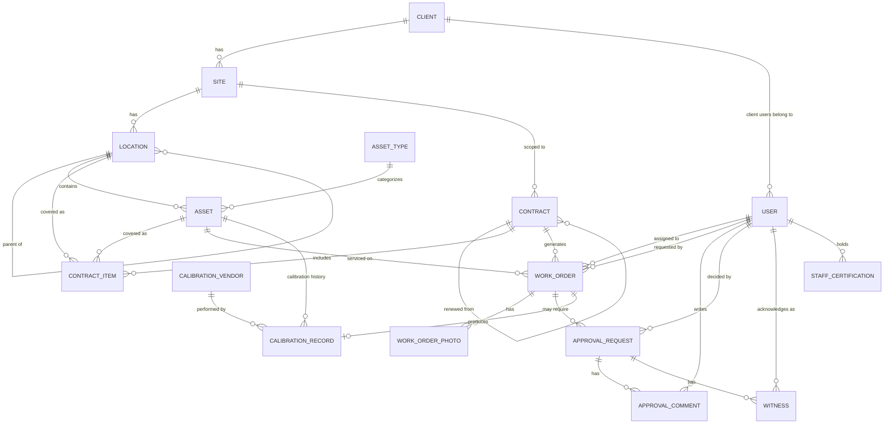

# Hospifit — Entity-Relationship Diagram

This is a planning-level data model derived from [PRD.md](PRD.md) and [ARCHITECTURE.md](ARCHITECTURE.md).
It describes entities and relationships, with representative fields per entity — not a
migration-ready column list. Field types/constraints get finalized when the migrations are
actually written. Per ARCHITECTURE.md §16, all field/table/enum names below are the English
identifiers stored in code/DB — user-facing display text is a separate (Indonesian)
presentation concern, not shown here.

## Diagram

## Entities

### `Client`
A customer organization. Owns one or more Sites and the Client-side Users who log in.
- `name`, `status` (active/inactive)

### `Site`
A physical facility belonging to a Client (e.g. a specific hospital or clinic). The root of
that facility's Location tree. Holds the geofence default (lat/lng/radius) inherited by its
Locations unless overridden.
- `client_id`, `name`, `address`, `latitude`, `longitude`, `geofence_radius_m`

### `Location`
Self-referencing node representing a level of physical space within a Site — Building, Area,
Room, or whatever depth a given client needs. Arbitrary depth via `parent_location_id`
(`null` = directly under the Site).
- `site_id`, `parent_location_id` (nullable), `type` (building/area/room/…), `name`,
  `maintenance_interval` (nullable — default preventive-maintenance cadence for Assets under
  this node, resolved by walking up the tree if not set here), `latitude`/`longitude`/
  `geofence_radius_m` (nullable override of the Site's default)

### `AssetType`
A category of asset (e.g. "AC Split", "Patient Monitor") used to share sensible defaults
across many Assets.
- `name`, `default_maintenance_interval` (nullable fallback if Location has none set),
  `default_instructions` (reference guidance shown to Field Staff, not mandatory),
  `requires_calibration` (bool, default for Assets of this type),
  `default_calibration_interval` (nullable, used when `requires_calibration` is true)

### `Asset`
One physical, client-owned item under a Location, identified by a Hospifit-generated
barcode.
- `location_id`, `asset_type_id` (nullable), `name`, `barcode` (unique, system-generated),
  `serial_number` (nullable, client/manufacturer-provided if known),
  `maintenance_interval` (nullable override of the Location's/AssetType's default),
  `instructions_override` (nullable, overrides AssetType's default),
  `requires_calibration` (nullable override of AssetType's default),
  `calibration_interval` (nullable override of AssetType's default calibration cadence —
  independent of `maintenance_interval`),
  `status` (available/under_calibration/out_of_service)

### `Contract`
An agreement with a client, scoped to one Site.
- `site_id`, `renewed_from_contract_id` (nullable, self-reference for duplicate/renewal
  chains), `start_date`, `end_date`, `status` (draft/active/expired)

### `ContractItem`
Pivot marking what a Contract covers — either an entire `Location` subtree or a specific
`Asset`. Exactly one of `location_id` / `asset_id` is set per row.
- `contract_id`, `location_id` (nullable), `asset_id` (nullable)

### `WorkOrder`
A unit of work — one visit or job. One of three types, generated from a Contract's schedule
(`type = preventive`), raised ad-hoc (`type = corrective`), or triggered by a calibration
due-date (`type = calibration`). Check-in/out and GPS are captured directly on the Work Order
for visit-based types since each represents a single visit.
- `contract_id` (nullable — corrective/calibration work outside any active contract's
  coverage is still possible), `asset_id`, `type` (preventive/corrective/calibration),
  `status` (pending/assigned/in_progress/completed/deferred), `requested_by_user_id`
  (nullable, set for corrective requests — internal or client user), `assigned_to_user_id`
  (Field Staff, nullable for externally-performed calibration), `notes` (free text),
  `scheduled_at`, `checked_in_at`, `check_in_latitude`/`check_in_longitude`,
  `check_in_within_radius` (bool, advisory flag not a gate), `checked_out_at`

### `WorkOrderPhoto`
Before/after photo evidence attached to a Work Order.
- `work_order_id`, `type` (before/after), `path`

### `ApprovalRequest`
A shared mechanism (ARCHITECTURE.md §14) for anything a Client Admin/PIC must decide on before
work proceeds: a Corrective Work Order's additional cost, or a Calibration's proposed
schedule (optionally bundled with an estimated cost, for out-of-contract calibration).
- `work_order_id`, `subject` (cost/calibration_schedule), `proposed_amount` (nullable),
  `proposed_date` (nullable, used for calibration scheduling), `status`
  (pending/approved/rejected), `decided_by_user_id` (nullable, Client Admin/PIC),
  `decided_at`, `escalation_reminder_sent_at` (nullable)

### `ApprovalComment`
One message in the threaded discussion on a pending `ApprovalRequest` — either side can post
while the request is undecided.
- `approval_request_id`, `author_user_id`, `body`, `created_at`

### `Witness`
Internal staff who acknowledge awareness of a pending `ApprovalRequest` — auto-populated
(e.g. the client's account owner, the job's assigner) plus any manually added.
- `approval_request_id`, `user_id`, `acknowledged_at` (nullable until they've seen it)

### `CalibrationVendor`
An accredited external organization/lab that performs calibration on Hospifit's behalf. Not
an individual — the technician who attends is recorded per-record as free text, not a
separate profile (PRD §6.4, out of scope §3).
- `name`, `accreditation_number`, `contact`

### `CalibrationRecord`
One completed calibration for an Asset, whether performed internally or by a
`CalibrationVendor`.
- `asset_id`, `work_order_id`, `calibration_vendor_id` (nullable — set only when performed
  externally), `technician_name` (nullable free text), `certificate_number`, `performed_at`,
  `next_due_date`, `result` (pass/fail/conditional_pass), one or more file attachments
  (certificate/report — no granular per-parameter measurement fields are stored)

### `StaffCertification`
A calibration-related certification held by a Field Staff `User`, used to flag (not block)
assigning uncertified staff to internal calibration Work Orders.
- `user_id`, `type`, `valid_until`

### `User`
Covers every role in PRD §4. `client_id` is set only for Client Admin/Client Staff and scopes
all their access to that Client's data.
- `name`, `email`, `role` (admin/office_staff/field_staff/client_admin/client_staff),
  `client_id` (nullable — null for internal roles)

## Derived / computed (not tables)

Per [ARCHITECTURE.md](ARCHITECTURE.md) §17, the contract progress meters (visits completed
vs. contracted, items handled, accumulated approved additional-cost value, and — for
contracts covering calibration-required assets — how many are currently
calibration-current) are computed from `WorkOrder`/`ApprovalRequest`/`CalibrationRecord` rows
at read time for MVP, not stored as separate summary tables.
